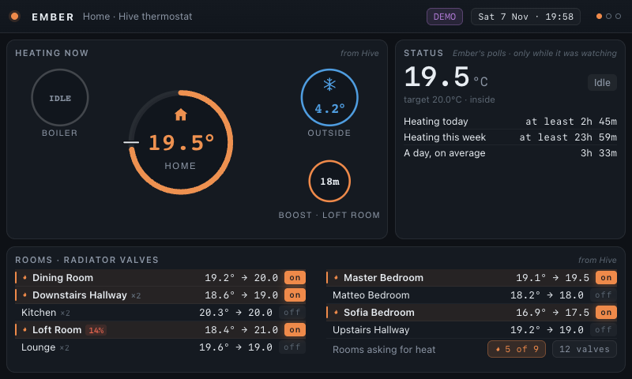

# Ember

A self-hosted dashboard for **Hive heating** and **Octopus gas**.

It runs on a Raspberry Pi and shows three slides on a 7" 800×480 panel: what
the heating is doing now, what the gas meter has read, and what tomorrow is
likely to cost.

**Standard library only.** No `pip install`, no build step, no Node — Python
3.9 or newer (`zoneinfo`, and nothing else) and three files of HTML, CSS and
JavaScript.

**Set it up in the browser.** There is a settings page at `/settings`: paste
your Hive login and your Octopus API key, and Ember works out the account,
the meter, the tariff and the rates for itself. Nothing to copy between
machines and nothing to remember to run first.



## Why

Hive knows the heating. Octopus knows the gas. Neither one knows both. Hive's
app can tell you how long the boiler has been on but has no idea what the gas
cost; Octopus can tell you what the gas cost but has no idea why. Ember puts
them side by side and joins them to the outside temperature, so you can see
**whether a high-gas day was a high-heating day or something else**.

---

## Running it

### Try it

```bash
git clone https://github.com/gosdenj/ember-dashboard
cd ember-dashboard
python3 run.py --demo        # generated data, no account needed
```

Then open <http://127.0.0.1:8766>.

### Set it up

Start Ember and open **<http://127.0.0.1:8766/settings>**.

The page asks for the two things you actually have — your Hive login and your
Octopus API key — and works out everything else by talking to the services:

- **Octopus.** Your API key is enough. Ember finds your account number (the
  GraphQL API knows which accounts a key can see), the meter point, every
  meter on it, the tariff in force, the rates, and the unit — because the
  meter's own record says what it measures.
- **Hive.** Your email and password. If Hive sends a two-step code, a box
  appears on the page and you type it in; the phone is the only place that
  code exists. The session is written where Ember can refresh it unattended
  from then on, and **the page says exactly where it put it**.
- **Your postcode.** Looked up in the UK's own postcode directory
  (postcodes.io) and turned into a latitude and longitude. It needs no key,
  and it does not mind whether you type `PO4 0PL` or `PO40PL`. A town name
  falls back to Open-Meteo's geocoder, which knows towns but **not** British
  postcodes — not one of them, not even `SW1A 1AA`.

The page keeps what you have typed in the browser's local storage, so a reload
does not throw the work away. The settings Ember is really using live in the
settings file, written `0600`, and the page always shows those in preference
to the remembered ones. Once a sign-in has worked the secret is taken back
out of the browser: it lives in the settings file now, and a copy in
`localStorage` is only a liability.

The page also shows **Stored history** — how big the database has got, how
many rows of what are in it, how fast it is growing and how long it is kept
for — and a **Tidy up now** button.

> **There is no login on the settings page.** It is meant for a private
> network, and a login that everyone shares is not a login. Anyone who can
> reach it can read and change the settings, so keep it on your own.

### Options

| Flag | What it does |
|---|---|
| `--host` | What to bind to. Defaults to `127.0.0.1`. |
| `--port` | Defaults to `8766`. |
| `--demo` | Generated data instead of the real accounts. |
| `--data-dir` | Where the settings and the history live. |
| `--settings` | Path to one specific settings file. |
| `--check` | Check both accounts, print what is wrong, and exit. |
| `--verbose` | Log every request. |
| `--version` | Print the version and exit. |

> The server binds to localhost by default because the settings page can write
> your Hive password and Octopus API key. `--host 0.0.0.0` puts it on the
> network — only do that on a network you trust.

Every setting can be an environment variable: `EMBER_` plus the setting name
in capitals and underscores (`EMBER_OCTOPUS_API_KEY`, `EMBER_HIVE_EMAIL`,
`EMBER_POSTCODE`…). The environment wins over the file.

### Settings

The settings page has a box for each of the ones below that it covers. The
rest live in the settings file.

| Setting | Default | What it does |
|---|---|---|
| `hive_email`, `hive_password` | | Your Hive login. |
| `octopus_api_key`, `octopus_account` | | Your Octopus key, and the account if the key can see more than one. |
| `postcode` | | Looked up for the weather. |
| `panel_name` | `Home` | Shown in the header. |
| `slides` | heating, gas, today | Which slides to show. |
| `rotation_seconds` | `20` | How long each slide stays up. `0` means it stays. |
| `poll_seconds` | `120` | How often Ember asks the accounts for a reading. |
| `monthly_budget` | `60` | What the budget tile compares against. |
| `base_temperature` | `16` | The base temperature of the degree-day model. |
| `calorific_value` | `11.16` | kWh per m³, from your bill. |
| `gas_unit` | `auto` | `m3` or `kwh`, to stop Ember guessing. |
| `clock_24h` | `true` | 24-hour clock in the header. |
| `history_days` | `400` | How long the meter's readings are kept. |
| `trv_days` | `30` | How long the log of which room was asking for heat is kept. |
| `timezone` | `Europe/London` | What a "day" means. |

### In a container

Ember is standard library only, so there is nothing to install in the image
and nothing to compile:

```bash
docker compose up -d --build
```

The settings, the history and the Hive session live in `./data` on the host,
mounted into the container, so a rebuild never loses them and the image never
carries the password or the API keys.

To have Portainer deploy it from this repository instead — building the
image on every push and rolling it out — see
**[docs/PORTAINER.md](docs/PORTAINER.md)**. That one keeps the same data in a
named volume, `ember-data`, rather than in a folder.

---

## What it shows

### The three slides

| Slide | What it is for |
|---|---|
| **Heating now** | The house's temperature, the boiler, the weather outside and any boost — with every room and every radiator valve below. |
| **Gas** | What the meter has read: a week of days, the shape of a day, or a calendar of the month — with today's figures and six tiles underneath. |
| **Today** | Today's gas and today's heating side by side, tomorrow's forecast, and the week behind them. |

They rotate every 20 seconds. `/?slide=gas` pins one slide, which is handy
for a bookmark.

Each slide is dealt onto the panel like a card: the new one slides in from
the right and the one it replaces fades away underneath it. Going backwards it
comes in from the left. **A new reading for the same slide does not move
anything** — the panel is rebuilt every two minutes, and a screen that is
never still is a screen nobody can read. The header stays where it is while
all that happens: it carries the clock, and it is the one part of the screen
that does not change.

**Swipe it.** Drag the panel to the left for the next slide, or to the right
for the one before — the same as the arrow keys. A drag has to be longer than
60px and clearly across rather than down, so reaching for a control does not
change the slide by accident.

### The type

The panel is drawn at 800×480 and shown 1:1, so every size in `app.css` is a
pixel count against a real 7" screen. **The type scale is the thing that makes
the panel readable from across the room** — the big figures are the ones you
want at a glance, the small ones are the ones you lean in for.

Every size went up by one point (9px became 10px, 34px became 35px, and so
on), because the whole scale moved up together and the hierarchy stayed
exactly where it was. The cost was space, and the space came out of the
padding rather than out of the type: the panels and the tiles gave up a
pixel or two of padding, the rows gave up a fraction of a pixel each, and
the tile labels tightened their tracking.

Two things worth knowing about that:

- **The tile labels must not wrap.** A wrapped label makes every tile in the
  row taller, because the grid stretches them, and that squeezes the row
  above it. One label wrapping is enough to break a slide.
- **The settings page keeps its own sizes.** It is a web page for a phone or
  a laptop, not the panel, and it is not drawn at 800×480.

### The heating panel

Four rings: **home** in the middle, the **boiler** and the **outside** in the
corners, and the **boost** underneath the outside ring.

**The home ring is a thermometer.** Its length is how warm the house is on a
fixed scale from 5 °C to 25 °C, and its colour is that same scale's ramp —
the weather's blue when the house is cold, the boiler's orange when it is
warm — with the house and the number in the middle taking the same colour.
Both come from one number, so the ring cannot say one thing with its colour
and another with its length. The white notch across the ring is where the
**setpoint** sits on that same scale, so the setpoint is visible without the
ring changing length when the heating schedule moves.

**The outside ring wears the same ramp.** It stays a solid circle — it is not
a gauge, and a second arc would only compete with the home ring's — but its
colour comes from the same scale and the same ramp, so the same temperature is
the same colour in or out. A blue outside ring beside an orange home ring says
what it looks like: cold out, warm in. The snowflake, the sun and the number
take the ring's colour too.

**The other rings say what they are.** A flame for a boiler that is firing, a
snowflake for a cold morning, a sun for a warm one, a plain thermometer for
anything in between.

**The boost ring shows whose boost it is.** A boost can be on the boiler or on
one room's valve, and they are different things: the boiler's lifts the whole
house to a higher target, a room's holds that one valve open for extra heat.
The ring shows whichever one ends soonest and labels it — *BOOST · KITCHEN* —
because a ring that says "BOOST" and does not say what is boosted is a puzzle.

Below the rings, every room has its own row: the temperature, the target, and
a badge saying whether the valve is open or shut. A room asking for heat is
marked in the row itself, and the summary line counts them — *5 of 9* — so
the one that says somebody is waiting for heat is not easy to miss.

### The gas slide

Three panels: the chart, today's figures, and today at a glance.

**The chart** has three views, and the tabs switch between them. Each one
names itself in the panel heading, because a panel that says "last 24 hours"
and shows something else is a lie:

| Tab | What it shows |
|---|---|
| **DAY** | the *shape of a day*: each hour's **average** use across the last week |
| **WEEK** | **a week of days**: one column per day, the week's average as a dotted line, today's estimate in plum |
| **MONTH** | **the month**: a calendar of the last 30 days, shaded by usage |

The week is the default, because "how much" is what the gas slide is for. The
shape of a day is on the Today slide, because "when does this house use gas"
is the question that panel was missing.

**A day the meter has not reported is never drawn as a zero.** Zero means no
gas was used, which would be a lie. In the week view the column is drawn in
**plum** with the band's whisker over the top, and a day with *part* of a
reading keeps that part in teal, faded, under the estimate. In the month view
it is a **dashed cell**, because the calendar's job is to show the pattern of
the month, and the pattern includes a meter exchange. The legend under the
chart says which is which.

**Today's figures** are the day's volume and what it cost, broken down into
the energy charge and the standing charge — the two add up to the cost above
them — with the unit rate and the unit itself. The two charges are named as
rows, so the panel does not need a sentence saying what the cost is made of;
it says which unit the readings are in and **why**, so the numbers can be
argued with.

The tile is tight on a 7" panel, and it is the last row that goes when it is
too full — so the unit rate is the thing to watch. There is no caption under
the rows for that reason: it was the thing that squeezed them.

**Today at a glance** is six tiles: gas today, cost, the 7-day average, how
today compares with it, the peak hour, and the month so far.

- **vs average** compares today with the average. When the meter has not
  reported yet it compares the *estimate* — a whole day against whole days —
  and says so.
- **Peak hour** is the peak of a **typical day**: the average use in each
  hour of a day across the last week. It answers the question a person
  actually has, *when does this house use gas?*

### The Today slide

Today's gas and today's heating, side by side, because that is the whole
point of the thing: the big figure is the gas so far, and under it is what
it has cost and how long the heating has been on. Beside it, how today
compares with the week's average and how the month is going.

**Today and tomorrow** read like the forecast on a phone: a symbol and a word
for each (*Clear*, *Partly cloudy*, *Rain*, *Snow*, *Fog*, *Thunderstorm*),
and nothing said about a code Ember has not seen. Under it sits tomorrow's
gas — the plum figure, the cost, the degree-days at the base temperature, and
the note about how many days the fit is standing on.

That tile is the tightest one on the panel, and it is tight for a reason: the
week strip underneath it is as tall as it needs to be, so whatever the tile
above gives away, the tile below takes. The forecast note is the last thing in
it, and a note that ends exactly on the panel's edge is one line away from
being cut off. So it has to have room at the bottom, and it does.

**The week** is a strip of days: what each one cost, the gas behind it, and
the heating hours beside it. Next to the heading is the **week's total** in a
pill — the sum of the days that have a cost, and nothing else. When any of it
is an estimate the pill carries a tilde and the plum of an estimate, so it never
claims to be more than it knows.

The heating hours are **the time the boiler was actually on**, and a line under
the strip says what is not settled: the days still waiting for the meter, and
the days Ember did not watch all of.

### The header

Three things on the right, answering three different questions: **DEMO** or
**LIVE** (whether Ember is talking to the real accounts), a warning pill with
the number of problems if there are any, and the clock — the weekday, the
date and the time, ticking every ten seconds so it stays honest between
polls.

---

## How the numbers are worked out

### Three kinds of number, and they never mix

| | what it is | where it comes from | how it looks |
|---|---|---|---|
| **measured** | what the meter actually reported | your Octopus meter | teal, no adjective |
| **estimated** | what today should use, given today's weather | Ember's own model, fitted to your readings | plum, and the word *estimated* |
| **forecast** | what tomorrow should use | the same model, plus the forecast | plum, and the word *forecast* |

A measured figure is never replaced by an estimate. When the meter has
reported today, Ember shows what the meter said and nothing else.

### Today's gas is estimated, because the meter has not reported it yet

Octopus does not deliver gas as it happens. Today's readings arrive tomorrow,
so on any given day "today" has no measured gas in it at all — and a panel
that only ever shows what has been measured would be a panel with a hole in
it.

But today is not a mystery. The same degree-day model that forecasts
tomorrow can be run for today: it knows how cold today is, and it knows what
a day like today cost before. Ember publishes that as an **estimate**, with
the volume, the band — how wrong it is likely to be — the cost when the
tariff rate is known, the mean temperature and the degree-days it used, and
the number of days the fit is standing on.

Two things it will not do. It will not use the mean of the hours so far — a
half-finished day is colder than the day it belongs to, so that would
under-predict every time, and the error would be invisible because the answer
would still look plausible. And it will not publish money when the unit is
unknown, for the same reason the measured figures do not: no unit, no cost.

### The week, in cost

The week strip shows **what each day cost**, in big type, with the gas that
produced it underneath in small type and the heating hours beside it. A day
of gas and a day of heat together is what says whether the gas was the
heating.

- **A day is costed at the rate of that day**, not today's rate. The rates
  endpoint is asked for the last seven days anyway, so a tariff switch in the
  middle of a week does not price the days before it at the rate after it.
- **A day the meter has not reported is estimated, not blank.** Those days get
  the same model, the same band and the same plum, with a tilde in front of
  the cost: `~£2.58`. When the real readings arrive they take the estimate's
  place; an estimate never replaces a reading, and a reading never replaces
  an estimate with a guess.
- **A day that is only half read is estimated too**, because a half-read day
  is not a cheaper day — the strip compares whole days with whole days.
- **The week's total is the sum of the days that have a cost.** A day the meter
  has not reported is left out of it rather than guessed at, so the total is
  never more than the panel knows. When any part of it is an estimate the total
  says so with a tilde and wears the plum, exactly as the tiles do.

Ember's weekly costs and the Octopus app's are **not the same kind of
number**, and that is the whole difference. Octopus's app shows an estimate
and says so; Ember shows the metered cost for the days the meter *has*
reported, and its own estimate for the days it has not. On a reported day
Ember's figure is the real one and Octopus's is a guess; on an unreported day
they are two different estimates. Ember marks which is which.

### The gas unit, and when Ember publishes no money

The readings themselves never carry a unit — the consumption endpoint returns
`consumption`, `interval_start` and `interval_end` and nothing else. But the
**meter record** does: it carries `meterType` (SMETS2 or SMETS1) and
`consumptionUnits` (M3 or kWh), and SMETS2 meters read cubic metres while
SMETS1 meters read kWh.

Ember asks the meter first. When there is no meter type to be found it falls
back to the size of the numbers — a home with gas heating burns tens of kWh a
day, which is a couple of cubic metres, and those two ranges barely overlap
— and it reports what it decided *and why*, marks it as a guess, and lets you
override it: set `gas_unit` to `m3` or `kwh` and Ember stops guessing.

**When the unit is not known, Ember publishes no money.** No kWh means no
cost, no energy figure, no budget percentage and no forecast in money. Ember
shows a dash and says why. A `0.00` would read as "nothing spent", which is a
different claim from "not known".

**Gas in m³, kWh derived.** A SMETS2 meter reports m³. Tariffs are priced in
pence per kWh. So Ember converts, using the calorific value — about 11.0 to
11.2 kWh/m³, depending on the gas and the month. Your bill states it in
MJ/m³ (usually 39 to 40); Ember converts with `kWh = m³ × CV × 1.02264 ÷
3.6`, the same way Octopus does. A bill value of 39.5 MJ/m³ works out at 11.22
kWh/m³. It is a setting you can correct, not a default baked in.

**Octopus's readings arrive with a lag, and Ember says so.** A day with no
readings is a day that has not been reported yet, not a day with no gas in it
— so Ember shows a dash rather than `0.00`, tells you how far behind the
meter is, and leaves unreported days out of the forecast fit rather than
putting a zero into the regression.

**A meter exchange is not a fault, and Ember says that too.** When the meter
is replaced, the old one's readings stop on the day it was retired and the
new one can take a fortnight to start reporting. Ember notices that the
readings stop exactly on the day the old meter was retired and names the
exchange, with the date — because Octopus backfills the gap afterwards, and
the gap is not missing gas. While the gap lasts, the panels show **the last
day the meter actually reported**, labelled as such, never as today's.

### A day is a sum, never a count

On a clock change a British Gas day is 23 or 25 hours long, and the API
returns a matching number of readings. The day is found by local midnight to
local midnight, not by rolling 24-hour windows.

**Today's comparison is like for like.** At two in the afternoon, today is
compared with two in the afternoon on the other days — not with their whole
selves, which would always look bad.

### The forecast

```
gas_m3 = baseline + k × degree_days
degree_days = max(0, base_temperature - mean outside temperature)
```

The intercept is not optional with a combi boiler. Hot water and cooking
happen on roughly the same days whatever the weather, so they belong in the
constant, not in the heating term. A line forced through the origin would
push that constant use into the slope and over-predict every mild day —
which, in this country, is most days.

The fit is deliberately robust: a single odd day should not throw the whole
model out. The forecast always shows how many days went into it and how wide
the band around it is, and it says *forecast*, not *bill*.

### Heating hours

Hive's API reports the boiler as firing or not, right now. It does not report
"6 hours 20 minutes today" — that is a sum over time, computed in Hive's
cloud from history they keep. So Ember keeps its own history store: every
poll writes the boiler state and the outside temperature at that moment, and
the room log records each time a room changes from asking for heat to not
asking for it.

The figure is the **time the boiler was actually on**, counted from Ember's
own polls — not read from a schedule, and not the hours the schedule allowed.
The panel says so: *"heating is the time the boiler was actually on"*.

Three things make the count honest:

- **A gap Ember was not watching is not counted as heating.** Each poll is
  assumed to describe the period until the next one, so a six-hour break with
  the boiler on at the start would otherwise be counted as six hours of
  heating — hours that may never have happened.
- **How long is a gap "not watching"? Not a constant.** The ceiling comes
  from the data — the **typical** gap between the polls (the median, which
  ignores both an odd fast poll and the one long break) times a generous
  factor, with a floor under it. The factor is generous on purpose, because
  the two mistakes are not equally bad: skipping a watched interval puts the
  heating to zero, while counting a break only over-counts a little.
- **A single poll is not counted as heating for the rest of the day.** One
  reading at midnight says the boiler was on at midnight. It says nothing
  about the rest of the day.

So Ember publishes, for every day, **how much of it it was watching**, and
says so where it matters: *"Heating today"* and *"Heating this week"* read
*"at least 2h 00m"* when the count is a lower bound; the Status panel says the
hours come from **Ember's own polls, only while it was watching**; the week's
tiles mark a partly-watched day with a **+**; and a day Ember was not running
says **not recorded**, not `0h 00m`, because a zero is a claim — and the claim
would be "the heating never came on", which is not what happened.

The count is still a sample — the boiler's state is only known at the moments
Ember polled it, so a run shorter than the poll interval can be missed. At two
minutes that is not worth worrying about.

### The history store

Ember keeps a small SQLite file so it can show heating hours, compare the
week and fit the forecast. It is bounded, and the bound is enforced once a
day:

| table | what it holds | kept for | grows by |
|---|---|---|---|
| `gas` | the meter's readings | **400 days** | 24 rows a day |
| `polls` | the boiler state at each poll | **400 days** | 720 rows a day (one every two minutes) |
| `trv` | which room was asking for heat | **30 days** | a handful of rows a day |

The room log records a row only when a room's state *changes*, which is the
more useful record anyway: it is the list of moments a room started or
stopped asking for heat. That is a few dozen rows a day rather than one for
every room on every poll.

Four hundred days of gas is a little over a year, so a year-on-year
comparison is possible; past that the oldest readings go. The window is a
setting (`history_days` and `trv_days`) and the settings page shows the size
of the file and how fast it is growing, with a **Tidy up now** button if you
want it done immediately.

**Ember asks for a month of readings when it starts.** The store begins empty,
and a chart of the week needs a week. Octopus keeps about a month of
readings, so the first fetch asks for the lot; after that only the last two
days are new, and that is all the quick poll needs. Once a day the whole
month is fetched again, which fills any gap the meter left and picks up
readings Octopus revised.

**A day is complete when the meter has reported a row for every hour of it**
(two may be missing; an odd half-hour does go missing now and then). Octopus
returns a row for every interval, zeros included, so the count is meaningful.

---

## Keeping it running

### On the Pi

Ember serves itself:

```bash
cd ember-dashboard
python3 run.py --host 0.0.0.0 --port 8766
```

Then point the kiosk browser at it:

```bash
firefox-esr --kiosk http://127.0.0.1:8766
```

The panel is 800×480, which is exactly the canvas Ember was drawn at, so it
shows 1:1 and pixel-perfect. On a bigger screen the same canvas is scaled up.

### As a service

```ini
# /etc/systemd/system/ember.service
[Unit]
Description=Ember
After=network-online.target
Wants=network-online.target

[Service]
Type=simple
User=gosdenj
WorkingDirectory=/home/gosdenj/ember-dashboard
ExecStart=/usr/bin/python3 run.py --host 0.0.0.0 --port 8766
Restart=always
RestartSec=5

[Install]
WantedBy=multi-user.target
```

```bash
sudo systemctl enable --now ember
```

> On a unit that is only pulled in by `graphical.target`, do not add
> `After=multi-user.target`: it will sit in `Active: inactive (dead)` with a
> `Job:` line, which means *queued*, not crashed. Enable it in both targets
> instead.

### When something is wrong

```bash
python3 run.py --check
```

It checks both accounts, says which session files it found and which are
missing, prints the meter, the product, the tariff and the rates, and lists
anything the dashboard could not reach — then exits without starting the
server. Worth running first when a panel comes up empty.

---

## Diagnostics

The settings page does the setup. The probes under `probes/` are still worth
having: they are the sharpest way to see what an account actually contains,
and they are what to run when the shape of an API moves.

```bash
cd probes
HIVE_USER=you@example.com HIVE_PASS=your-password python3 probe_hive.py
OCTOPUS_API_KEY=sk_live_... python3 probe_octopus.py
```

`probe_hive.py` asks for the one-time code if Hive sends one, then registers
the device so it is not asked again. `probe_octopus.py` works out whether the
meter reads m³ or kWh, and what the tariff is.

Neither probe is part of the running app. They are diagnostics, and the
answers they produce seed the settings: the Octopus probe leaves
`probes/ember-settings.json` (mode `0600`) with everything the dashboard
needs, and the Hive probe writes `hive-session.json` to
`~/.local/share/ember/` and next to the probe itself. If you run the probe on
one machine and the app on another, copy those two files across.

---

## Layout

```
ember-dashboard/
├── run.py                  the entry point
├── ember/
│   ├── config.py           settings, with secrets kept out of the browser
│   ├── history.py          the SQLite history store
│   ├── hive.py             Hive: SRP sign-in, nodes, valves
│   ├── octopus.py          Octopus: meters, consumption, tariffs
│   ├── weather.py          Open-Meteo + postcodes.io, no key needed
│   ├── forecast.py         the degree-day model
│   ├── discover.py         working the settings out from a key
│   ├── dashboard.py        the polling loop and the payload
│   ├── demo.py             generated data, for before there are accounts
│   ├── server.py           HTTP and Server-Sent Events
│   └── web/                index.html, settings.html, app.js, theme.css, fonts/
├── probes/                 the diagnostics
├── tests/                  the test suite
├── design/                 the design pages the panels were drawn on
├── docs/                   PORTAINER.md, and the screenshots
├── Dockerfile
└── docker-compose.portainer.yml
```

---

## Tests

```bash
cd ember-dashboard
python3 -m unittest discover -s tests -v
```

The browser tests need Playwright and a Chromium; where they are not
available those tests skip rather than fail, so the rest still runs.

---

## Privacy

Read-only. Ember never writes to Hive and never changes your heating.

Your credentials live in one file, written `0600`, and they are never sent
back to the browser. The `/api/settings` endpoint returns everything except
the secrets, and only reports whether a secret *is* set. The settings page
shows what you have typed — which is the one place a secret is in the
browser, because that is where you typed it — and a button that makes the
browser forget it again.

**No endpoint hands back a credential.** Not the password, not the Octopus
API key, and not the Hive tokens: the sign-in route returns a whitelist of
what the page may show, and the refresh token — a long-lived credential for
the Hive account — never leaves the process. The settings file and its
temporary copy are both created `0600` from the start, because the password
is in plain text in both.

The settings page has no login. It is meant for a private network, and a
shared password is not a login. Anyone who can reach it can change Ember's
settings, so keep it to a network you trust.

---

## Licence

MIT.
